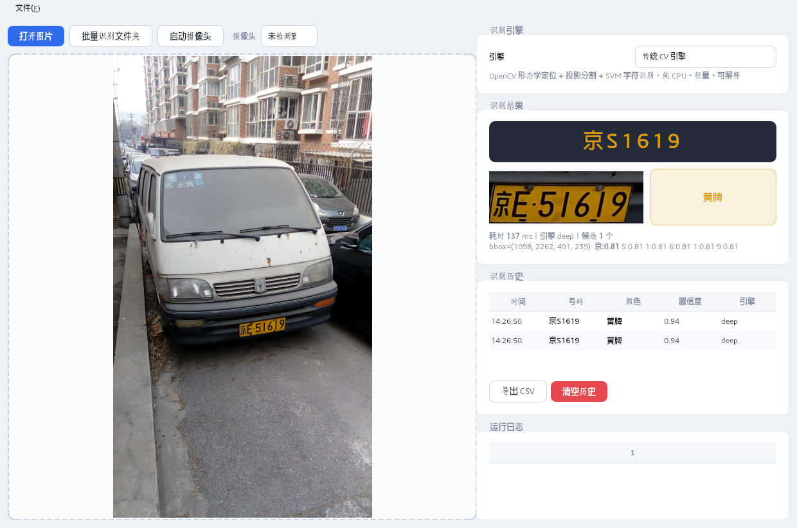

# 车牌识别系统 v2.7.2（License-Plate-Recognition 升级版）

用 Python + OpenCV + 深度学习做的**中国车牌识别**，支持蓝牌 / 黄牌 / 绿牌（新能源）/ 白牌 / 黑牌。



本项目是 [hongligongsi/License-Plate-Recognition](https://github.com/hongligongsi/License-Plate-Recognition) 的现代化升级版。原项目最后一次提交停留在 2021 年，其依赖（Python 3.4 / OpenCV 3.4 / numpy 1.14）在如今的机器上已无法安装。v2 在保留原算法思想的基础上全面重构，详见 [UPGRADE.md](docs/UPGRADE.md)。

> **v2.1 主题：更精准、更快速、更安全、更全面。** 详见下方「v2.1 四大升级」。
> v2.2 补上「版式维度」与 12 大类车牌；v2.3 做召回分层与形近字纠错；
> v2.3.1 修掉 4 个真 Bug（安全层覆盖、采集/识别解耦、模型校验三态）并补上 CI；
> v2.3.2 专项提升军牌/警牌/白牌等特种号牌（语法补齐 + 红色字符判色）。
> v2.3.3 补上启动入口（`python -m lpr`）、Windows 一键启动 `start.bat`
> 与「环境与系统要求」说明，并修掉摄像头后端的跨平台硬编码。
> v2.3.4 修复角点排序在侧倾 >45° 时把车牌矫正成竖图的缺陷（±89° 全范围
> 归位），并按 GA 36-2018 /《警车管理规定》核对了三处号牌规范口径。
> v2.3.5 修掉 `start.bat` 的依赖误判（只查 PySide6，不查 numpy/OpenCV）——
> 在没有 `.venv` 的机器上会先装 220 MB 再以 `ModuleNotFoundError` 告终；
> 改为「缺依赖就建项目内 `.venv`」，不污染用户已有解释器。
> v2.3.6 把中文提示从 `.bat` 里搬走——cmd 用上一行的「字符数」当字节偏移，
> 文件里出现汉字就会读错行、把残片当命令执行；启动器改成
> 「纯 ASCII 引导壳 + Python 打印中文」两层结构。
> v2.3.7 让「打不开摄像头」的提示变得可行动（自动枚举可用设备 + 排查清单），
> 并在工具栏新增摄像头选择；v2.3.8 重做了界面视觉（工具条上移、深色车牌
> 展示卡、颜色徽章修色、表格/滚动条/菜单全面统一）；v2.3.9 二次打磨并揪出
> 两个老 Bug；v2.4.0 加严早停并引入 ROVER 风格读数融合（识别率专项）。
> v2.4.1 修掉引擎下拉弹层条目「隐形」（白底白字）；v2.4.3 让识别历史行
> 点击回显该条结果，并把 CI 从 5 项红修到全绿（3.10 无 `tomllib`、mypy
> 未使用 ignore、rapidocr 版本漂移致准确率门槛抽奖、Windows 管道编码），
> 同时把项目许可从 MIT 切到 GPL-3.0-only；v2.4.4 新增 `yolo` 检测识别
> 引擎骨架（第三个引擎，ONNX 推理，权重需自行准备）。
> **v2.5.0 把 `yolo` 从骨架补成可用引擎**：实装 ONNX 推理全链路
> （letterbox → 输出解码 → 类别感知 NMS → 逆 letterbox → 四点透视矫正 →
> 字符识别），识别侧默认复用 `deep` 引擎的 OCR，另配三条取权重的路
> （公开权重校验下载 / CCPD 自训练导出 / 纯检测模式），并提供了
> **不依赖任何第三方权重**的桩模型自检工具，让 CI 能真正跑通整条管道。
> v2.5.1 用真实 GPL 权重实测跑通（`京E51619` / `京PAP315` / `京AD77972`），
> 并把 `attr_order` 接进配置（默认 `kpt_first` 对齐 we0091234 权重，
> GUI/CLI 开箱即用）。
> **v2.6.0 新增第四个引擎 `fusion`（三合一）**：把 `cv` / `deep` / `yolo`
> 编排成一个引擎，三种策略（并联投票融合 / 顺序兜底链 / 特征选优）配置切换，
> 成员缺权重自动退席，融合结果带各成员读数与票数明细。
> **v2.7.0 补上准确率实测**：100 张 CCPD + 10 张自有样张，六个配置横向对比、
> 失败按环节拆解、两项附加实验 —— 结论见
> [docs/ACCURACY.md](docs/ACCURACY.md)（简版：没有全能引擎；融合目前不提升
> 识别率；`auto` 的硬编码偏好已在 CCPD 上倒退 4 张，已改为可配置）。
> **v2.7.1 把启动器补完**：原先它只探测 Python 依赖，权重缺失时照样打印
> 「均已就绪」——用户看到的是界面里那行「（不可用）」。现在每次启动都会报
> 模型权重与四个引擎的可用性，并新增只读体检入口 `start.bat doctor`，
> 每条不可用都附确切的修复命令（见下方「四种启动方式」）。
> **v2.7.2 提准确率、补界面**：识别侧新增「补救预处理」—— 主识别计划的
> 6 轮只换放大/锐化的尺度、从不换增强方式，对"噪点把字形咬坏"无能为力；
> 现在主计划落空时自动换去噪 / 对比度均衡 / 二值化重试，实测 yolo
> 84%→85%、字符级 90.7%→93.6%、「有框无字」8→4 张（依据与代价见
> [docs/ACCURACY.md §5.3](docs/ACCURACY.md)）。界面侧把配置里躺了很久的
> `ui.theme` 真正落地（浅色/深色，Ctrl+1/2 切换），并补上候选列表、
> 拖拽打开、一键复制号码；待办清单位移交
> [docs/ROADMAP.md](docs/ROADMAP.md)。
> 逐版本记录见 [docs/UPGRADE.md](docs/UPGRADE.md)。

## 核心特性

- **多引擎可切换**（四个后端共用同一套接口，`lpr engines` 可列出可用性）
  - `cv` 传统 CV 引擎：OpenCV 形态学定位 + 投影分割 + SVM 字符识别（兼容原版模型），纯 CPU、**约 28 ms/张**、零额外依赖
  - `deep` 深度学习引擎：基于 RapidOCR（ONNX）/ PaddleOCR，中文省份简称与模糊车牌的准确率远高于 SVM，**约 190 ms/张**
  - `cascade` 级联：CV 快速定位给出候选 → 深度引擎精识别（精度与速度的折中），默认引擎
  - `yolo` 检测识别引擎（**已可用，需自备权重**）：车牌专用检测网络，一次前向同时给出 bbox + 四角点 + 单/双层分类，再用四点透视变换把倾斜车牌拉正后识别字符。对**侧倾、透视变形、模糊**车牌的定位召回优于轮廓法（`cv`/`deep` 靠形态学找轮廓，侧倾大了就找不到候选）。ONNX 推理，**不需要 PyTorch**。权重放到 `models/yolo/plate_det.onnx` 即自动启用；`python tools/fetch_yolo_weights.py --list` 看可取来源，或按 [models/yolo/README.md](models/yolo/README.md) 自行训练
  - `fusion` **三合一引擎**：把上面三个引擎编排成一个，三种策略可选
    （`engine.fusion_strategy`）：
    - `ensemble`（默认）**并联投票融合** —— 三个引擎各跑一次，落在同一处的框归为一组，
      组内按 `引擎权重 × 置信度` 投票，票高者胜出；结果里带 `meta["fusion"]`
      写明每个成员读了什么（谁是少数派一目了然）
    - `chain` **顺序兜底链** —— 依次尝试，拿到 `confidence ≥ 0.75` 的结果就停（省时）
    - `auto` **特征选优** —— 按长边分辨率与模糊度排序后按序试（小图/糊图先上检测网络），
      清晰大图的首选成员可配置（`engine.fusion_auto_clear_first`，默认 `deep`；
      实测依据见 [docs/ACCURACY.md §5.2](docs/ACCURACY.md)）
    成员缺权重或缺依赖会**自动退席**（少一票，不影响其余成员）；
    默认还带一条**准入规则**：孤立候选要凑到第二个成员的票才留，或票权达到 1.0
    才能独存 —— 因为实测 `cv` 在 4096×2304 的真实样张上会给 9 条候选（7 条误检），
    而 `yolo` 给 2 条全中；只做并集会让最弱成员污染输出
- **现代化 GUI**（PySide6）：单图 / 批量 / 摄像头实时识别，识别不再冻结画面，
  历史记录可导出 CSV；浅色/深色双主题（Ctrl+1/2 切换）、图片/文件夹拖进窗口
  即识别、结果区候选列表与一键复制号码
- **命令行工具**：`lpr predict`、`lpr video`、`lpr gui`、`lpr engines`、`lpr check`、`lpr models`、`lpr config`
- **参数自适应**：定位参数以比例表达，同一套配置适配 640px～4000px 输入（原版换分辨率就失效）
- **多车牌**：一张图里的多个车牌全部识别（原版只返回第一个）
- **置信度**：字符级 + 整体置信度，标注图可视化
- **中英文路径**：图片读写全兼容中文路径，自动纠正 EXIF 旋转

## v2.1 四大升级

### 一、更精准

| 机制 | 说明 |
|---|---|
| **定位引导识别** | 先用轻量 CV（~50ms）圈出车牌候选区，只对候选区做 OCR，避免全图噪声干扰 |
| **多尺度投票** | 超分（目标字符高 48px）× 锐化（USM）组合投票，票重 = OCR 置信度 × 语法合法性 |
| **早停收敛** | 首个尺度即得到合法号码且票数占比过半就停止，典型场景只跑 1～2 轮 |
| **语法纠错** | `plate_rules` 按真实车牌规则纠错（I/O 不合法、发牌机关须为字母、末位降级） |
| **跨帧投票** | 视频/摄像头用 `MultiPlateTracker` 关联轨迹，多帧投票纠正单帧偶发错误 |
| **同图去重** | 同一号码无论位置都合并为一条观测，位置相近但号码不同则同时保留（不漏报） |

### 二、更快速

关键突破是**跳过 OCR 的文本检测网络**：车牌的文本检测（DBNet）本身就是重型网络，而我们已用 CV 定位拿到了车牌区域，因此直接把整块 ROI 当作文本框送入识别网络（`get_boxes_img_without_det`）。

实测（`samples/`，每张重复 3 次）：

| 引擎 | 冷启动 | 中位耗时 | P95 | QPS |
|---|---|---|---|---|
| `deep` | 541 ms | **194 ms** | 507 ms | 3.8 |
| `cv` | 143 ms | **28 ms** | 31 ms | 35.5 |

对比 v2.0 的全图 OCR 路径（约 1600 ms/张），`deep` 引擎提升约 **8 倍**。

> 注：`cv` 引擎虽快，但 SVM 对任何输入都输出置信度 1.0（严重过自信）且字符识别错误率高，**仅供快速筛候选**，精度请用 `deep` 或 `cascade`。

### 三、更安全

`lpr.utils.security` 提供完整的输入防护与隐私脱敏：

| 模块 | 能力 |
|---|---|
| `Limits` | 文件大小上限（32MB）、像素上限（5000 万）、单边上限（20000px）、最小尺寸、批量文件数上限、扩展名白名单 → 防解压炸弹与畸形尺寸 |
| `check_file` / `check_image` | 读取前校验文件与解码后数组，异常抛 `SecurityError` |
| `PrivacyPolicy` | 输出/日志脱敏策略（`mask_output`、`mask_keep_tail`、`mask_logs`、`keep_roi`） |
| `mask_plate` / `scrub_value` | 单值打码 + **递归清洗任意嵌套结构**（`meta.variants` 这类旁路字段也会被打掉） |
| `MaskingFilter` | 日志过滤器，日志里的车牌号自动打码 |
| `RateLimiter` | 令牌桶限流，防并发识别打满机器 |
| `verify_model` / `check_model` / `sha256_file` | 模型哈希白名单校验，检测模型篡改。**三态结果**（`ok` / `skipped` / `mismatch`），"未配置白名单"不会再显示成"✓ 通过" |
| `safe_output_path` | 防路径穿越（`../../etc/passwd` 这类会被拦回基准目录） |

**脱敏是端到端生效的**：控制台输出、JSON、CSV、嵌套 `meta` 全部覆盖，均有单元测试守住。

**安全层覆盖三条入口**（v2.3.1 修复）：

| 入口 | 输入校验 | 输出脱敏 | 日志脱敏 | 模型校验 |
|---|---|---|---|---|
| `lpr` CLI | ✅ | ✅ | ✅ | ✅ |
| Python API（`Recognizer`） | ✅ | ✅ | ✅ | — |
| 图形界面（`lpr gui`） | ✅ | ✅ | ✅ | — |

> v2.3.1 之前，Python API 会**静默忽略** `config.json` 的 `security` 段
> （`LPR_MASK_OUTPUT` 也对 API 无效），图形界面则**完全没有接入安全层**
> —— 图片不校验、CSV 导出裸写明文。现在三条入口共用同一份 `config.security`。

模型哈希白名单开箱可用（`config.json` 的 `security.model_hashes` 已内置随仓库
分发的两个 SVM 模型哈希），换自训练模型后需同步更新，否则会被判为不匹配：

```bash
lpr models --verify
#   svm.dat                    4.38 MB  2026-10-11 23:05:06
#     ✓ 哈希校验通过 (ce3fdffb3e9529fc…)
# （✓=已校验通过，—=未配置哈希白名单故未校验，✗=不匹配）
```

```bash
lpr predict car.jpg --engine deep --mask          # 控制台输出打码
lpr predict ./photos/ --engine deep --mask --report out/   # 报告落盘同样打码
```

### 四、更全面

- **车牌底色（五种 + 危险品）**：

  | 底色 | 适用车辆 |
  |---|---|
  | 蓝色 | 小型汽车（最常见） |
  | 黄色 | 大型汽车、教练车 |
  | 绿色 | 新能源、农用 |
  | 白色 | 警用、军队、特种车辆 |
  | 黑色 | 使领馆、境外车辆 |
  | **危险品运输** | 黑底**黄字**，危险品运输车辆专用 |

  > 危险品牌与普通黄牌**底色相反**（普通黄牌是黄底黑字），仅看"有没有黄色"无法区分。
  > 实现上用**明暗极性判定**：要求「黑色主体占比 ≥ 45%」且「黄色前景占比 ≥ 3%」且
  > 「黄字只占少数（≥ 6% 的 黄/(黄+黑) 比值）」，第 1 条排除黄底黑字、第 2 条排除黑底白字。
  > 可用 `--color` 按底色过滤，例如只挑出危险品运输车：`lpr predict ./photos/ --color 危险品`

- **车牌类型（14 种格式 / 12 大类）**：普通民用（单行蓝牌、单行黄牌）/ 新能源（含双层绿牌）/ 警用（白色警用车牌，含双层白牌）/ 军队 / 武警 / 使领馆（使用馆车牌）/ 挂车 / 教练车 / **危险品运输** / 港澳入出境（粤Z 港澳牌）/ 短牌 / **民航**（`民航A0001`，绿底白字，依据 CCAR-331SB-R1）
- **版式维度（单行 / 双层）**：v2.2 起每个识别结果同时给出 `layout` 字段——版式与底色是**相互独立**的两个维度（同样是黄牌，小型教练车是单行、大型汽车后号牌是双层）。判定依据：行分割证据 + 宽高比先验（单行 440×140mm ≈ 3.1:1，双层 440×220mm ≈ 2:1）
- **双层牌处理**（借鉴 [YOLO26-plate](https://github.com/we0091234/Chinese_license_plate_detection_recognition)）：**先在候选阶段判定单/双层**，只有双层才拆行拼接——单行牌不做无谓的双倍识别。拆行用「裁左右边框 + 行投影」，不依赖固定比例，对带框车牌与任意宽高比都成立
- **输入来源**：图片 / 目录（可递归）/ 视频文件 / 摄像头流 / numpy 数组
- **输出格式**：控制台 / JSON / CSV / 标注图片 / 标注视频

## 环境与系统要求

### 最低要求

| 项目 | 要求 | 说明 |
|---|---|---|
| **操作系统** | **Windows 10 (1809+) / Windows 11（64 位）**、Linux（64 位） | 兼容矩阵见下 |
| **Python** | **3.10 ~ 3.13，必须 64 位** | `requires-python = ">=3.10"`；CI 覆盖 3.10 / 3.11 / 3.12 / 3.13 |
| **CPU** | 任意 x86-64 | **不需要 GPU、不需要 CUDA**，推理全程纯 CPU |
| **内存** | 可用 2 GB 以上 | deep 引擎加载 OCR 模型约占 500 MB |
| **磁盘** | 源码约 30 MB；装完依赖约 300 MB | 仓库自带 SVM 模型 8 MB；OCR 模型 13.7 MB 随 wheel 分发；`PySide6-Essentials` 约 100 MB、`rapidocr-onnxruntime` 约 130 MB |
| **网络** | **只在 `pip install` 时需要** | 装完后从识别到界面**全程离线**（模型都已随包分发） |
| **摄像头** | 可选 | 只有「摄像头实时识别」功能需要 |

### 系统兼容矩阵

| 系统 | 命令行 | 图形界面 | 说明 |
|---|---|---|---|
| **Windows 11（64 位）** | ✅ | ✅ | 本项目开发与实测环境（Python 3.13） |
| **Windows 10 1809+（64 位）** | ✅ | ✅ | CI 在 `windows-latest` 上覆盖 Python 3.12 |
| Windows 10（1809 之前，如 1607 / LTSB 2016） | ⚠️ | ⚠️ | 未验证。PySide6（Qt 6.6+）官方要求 1809 以上 |
| Windows 8.1（64 位） | ⚠️ | ❌ | Python 3.13 官方仍支持 8.1，但 Qt 6 已放弃 → **界面用不了** |
| Windows 7 | ❌ | ❌ | 见下「为什么 Windows 7 / 8 / XP 不行」 |
| Windows XP | ❌ | ❌ | 同上 |
| 32 位 Windows（任意版本） | ⚠️ | ❌ | Qt 6 没有 32 位 Windows 版 → 界面用不了 |
| **Linux（Ubuntu 20.04+ / 22.04+，64 位）** | ✅ | ✅ | CI 覆盖 Ubuntu × Python 3.10~3.13；摄像头走 V4L2 |
| macOS 12+ | ✅ | ✅ | Qt 6 要求 macOS 12+；本项目**没有** macOS 的 CI 覆盖 |

### 为什么 Windows 7 / 8 / XP 不行

两道**互相独立**的硬门槛，任何一道都足以挡住：

1. **Python 本体**。CPython 的规则是「只在 Microsoft 仍处于延长支持期的 Windows 上支持」。
   最后一个能装到 **Windows 7** 的版本是 **Python 3.8**（官方文档原话：
   *"If you require Windows 7 support, please install Python 3.8"*）；
   **Windows XP** 更早，止步于 **Python 3.4**。
   而本项目要求 `Python >= 3.10` —— 门直接关着。
2. **图形界面**。界面基于 **PySide6（Qt 6）**，官方支持矩阵是 **64 位 Windows 10 1809+**。
   Qt 6 明确放弃了 Windows 7 / 8 / 8.1 以及**全部 32 位 Windows**
   （要 Win7 就得退到 Qt 5.15，要 8.1 就得退到 Qt 5.12）。

> 想让它在 Win7 上跑，属于一次**独立移植**，不是改个配置就行：要降到 Python 3.8 +
> `PySide2`(Qt5) + 旧版 numpy/opencv，还得放宽 `requires-python`，并自行确认那些旧
> wheel 在 Win7 上装得上。本仓库没做、也没承诺这条路径。

### 四种启动方式

**① 双击（Windows 最省事）**

```
双击 start.bat
```

脚本会自动走五步：

1. **找解释器**：`LPR_PYTHON` 环境变量 → 项目内 `.venv` → `py -3` → `python`；
2. **校验版本**：低于 3.10 直接报错退出（而不是抛一堆 `ImportError`）；
3. **补齐依赖**：探测 **numpy / OpenCV / Pillow / PySide6 四项**是否齐全，
   缺则装 `-e ".[deep,gui]"`（核心库 + 深度引擎 + 界面，约 200 MB，只在首次）；
4. **自检模型权重与引擎**：看 `models/` 下的权重、逐个探测引擎后端
   （`rapidocr_onnxruntime` / `paddleocr` / `onnxruntime`），报出四个引擎谁可用；
5. **启动**：无参数开界面，有参数透传给命令行。

第 4 步只说事实，**不阻断启动**：缺了 `yolo` 的权重只是这个引擎不可用，界面和
其余引擎照常。它每次都会打印一行结论，例如：

```text
[4/5] 模型权重与引擎
      可用：传统 CV 引擎 / 深度学习引擎 / 三合一引擎
      不可用：检测识别引擎 —— 未安装 onnxruntime（检测推理后端）；缺少模型权重：models/yolo/plate_det.onnx
              修复：pip install -e ".[yolo]"
                    python tools/fetch_yolo_weights.py --list          # 已知来源与许可
                    python tools/fetch_yolo_weights.py --github <owner/repo> --asset "*det*.onnx"
      失去的只是对应引擎，界面与其他引擎照常可用；
      要看完整报告执行：start.bat doctor
```

缺依赖时**装进项目内的 `.venv`**，不会往你系统里已有的 Python 塞包；如果那个
解释器本来就齐全，则直接复用、不重复下载。第二次双击复用 `.venv`，秒开。

> **为什么逻辑不在 `.bat` 里？** `start.bat` 只是一个纯 ASCII 的引导壳，
> 真正的启动逻辑和中文提示都在 `tools/launcher.py`。
> 原因很硬：cmd.exe 计算批处理「下一行」的偏移时，拿上一行的**字符数**当
> **字节偏移**用，文件里只要出现一个汉字，下一行就会被超前若干字节开始读，
> 剩下的残片会被当成命令执行：
>
> ```text
>        完成 —— CV 引擎、深度引擎、图形界面均已就绪。
> '，未改动你系统里的' 不是内部或外部命令，也不是可运行的程序。
> ```
>
> 更坑的是它不稳定 —— 短文件里超前量往往刚好落在下一行的缩进空格里，
> 看起来完全正常。所以中文一律交给 Python 打印（Python 走 `WriteConsoleW`，
> 与控制台代码页无关）。

参数透传给命令行：

```bat
start.bat engines                                :: 查看引擎状态
start.bat predict car.jpg --engine deep          :: 单图识别
start.bat --help                                 :: 命令行用法
```

**`start.bat doctor` —— 只体检，不启动**

环境不对劲时（下拉框里某个引擎写「（不可用）」、装完依赖仍报缺模块），先跑它。
它把**解释器 / 运行依赖 / 模型权重 / 四个引擎**一次列全，每条不可用都附修复命令：

```bat
start.bat doctor          :: 也可以写 --doctor 或 --check
```

```text
运行依赖
  [ok] numpy                  可用     运行库（必需）
  [ok] cv2                    可用     运行库（必需）
  [ok] PIL                    可用     运行库（必需）
  [ok] PySide6                可用     图形界面（必需）
  [ok] rapidocr_onnxruntime   可用     deep 的默认识别后端（推荐，轻量）
  [--] paddleocr              未安装   deep 的备选识别后端（更大更慢），未安装不影响
  [!!] onnxruntime            不可用   yolo 的唯一硬依赖（默认安装规格不含）

模型权重
  [ok] SVM 分类器（字母数字）         4.38 MB   models/svm.dat
  [ok] 车牌检测网络（bbox + 四角点）  未提供    models/yolo/plate_det.onnx
        python tools/fetch_yolo_weights.py --list          # 已知来源与许可
  [--] 车牌字符识别（可选）           未提供    models/yolo/plate_rec.onnx
```

两条刻意的设计：

- **只读**：不建 `.venv`、不装包、不改任何文件，所以环境已经坏掉时也能放心跑；
  四个引擎全部可用时退出码 0，否则为 1（便于脚本判断）。
- **不制造假警报**：可选的东西缺了标 `[--]`（例如只装了 `rapidocr` 没装
  `paddleocr`），只有真正拖垮了某个引擎才会标 `[!!]`。

两个环境变量可覆盖默认行为：

```bat
set LPR_PYTHON=C:\Python312\python.exe   :: 指定解释器（跳过搜索）
set LPR_NO_VENV=1                        :: 不建 .venv，直接装进找到的解释器
```

**② 装成命令（推荐长期使用）**

```bash
pip install -e ".[deep,gui]"    # 一次性：CV + 深度学习引擎 + 图形界面
lpr gui                          # 开界面
lpr predict car.jpg --engine deep
```

**③ 不安装，直接用源码**

```bash
# Windows
set PYTHONPATH=src
# Linux / macOS
export PYTHONPATH=src

python -m lpr                    # 无参数 → 直接开图形界面
python -m lpr predict car.jpg --engine deep
python -m lpr.cli --help         # 只看命令行用法
```

**④ 最小安装（只要命令行 + CV 引擎，零额外依赖）**

```bash
pip install -e .
lpr engines                      # 看看当前环境有哪些引擎可用
```

### 引擎与依赖的对应关系

| 引擎 / 功能 | 额外依赖 | 装完后还要下载模型吗 |
|---|---|---|
| `cv`（基础） | 无（numpy + opencv + Pillow） | 否，`models/*.dat` 随仓库分发 |
| `deep`（推荐） | `rapidocr-onnxruntime` | 否，模型 13.7 MB 在 wheel 内 |
| `deep-paddle` | `paddleocr` + `paddlepaddle` | **首次运行会联网下载模型**，离线环境别用 |
| `yolo`（实验） | `onnxruntime>=1.16` | **是**，`models/yolo/*.onnx` 需自行准备 |
| `fusion`（三合一） | 无额外依赖（用成员各自所需的那份） | 取决于成员：`cv`/`deep` 装完即用，`yolo` 需权重 |
| 图形界面 | `PySide6-Essentials>=6.5` | 否 |

> 界面只用到 `QtCore` / `QtGui` / `QtWidgets`，因此依赖 `PySide6-Essentials`
> 而不是元包 `PySide6`——后者会连带装 `PySide6-Addons`（WebEngine / Charts /
> Multimedia / 3D 等，约 130 MB），本项目一个都不用。

> **纯离线环境请用 `deep`（RapidOCR）**：它和 `cv` 一样装完即用；
> `deep-paddle` 首次运行需要联网拉模型。

## 安装

```bash
# 基础（传统 CV 引擎）
pip install -e .

# 推荐：+ 深度学习引擎 + 界面
pip install -e ".[deep,gui]"

# 可选：PaddleOCR 后端（更大更慢但部分场景更准）
pip install -e ".[deep-paddle]"

# 可选：车牌检测网络引擎（ONNX 推理，需自备权重）
# 只装 yolo 则字符识别缺席（纯检测模式）；要和识别一起用请装 ".[yolo,deep]"
pip install -e ".[yolo]"

# 开发（含测试）
pip install -e ".[dev]"
```

> **`.[yolo]` 装在哪儿、权重放哪儿**：extras 只装 `onnxruntime`；**权重不进仓库**。
> 装完先跑 `python tools/make_stub_onnx.py --out models/yolo/plate_det.onnx --selftest`
> 验证管道通不通（这条不联网、不要第三方权重），再按
> [models/yolo/README.md](models/yolo/README.md) 换成真权重。

> **注意**：`opencv-python` 必须是 **4.x**（`>=4.10,<5`）。OpenCV 5.0 移除了 `cv2.ml`，原版 SVM 模型将无法加载，`pyproject.toml` 已锁定上限。

SVM 模型（`models/svm.dat`、`models/svmchinese.dat`）已随仓库附带，来自原项目（EasyPR 样本训练）。

## 使用

### 命令行

```bash
lpr engines                                       # 查看引擎状态与可用性
lpr predict car.jpg --engine deep                 # 单图识别
lpr predict ./photos/ --engine deep --recursive   # 目录批量（递归）
lpr predict ./photos/ --save-annotated out/ann --report out/   # 标注图 + JSON/CSV 报告
lpr predict car.jpg --engine deep --mask --json   # 脱敏输出
lpr predict ./photos/ --color 危险品              # 只保留危险品运输牌
lpr predict ./photos/ --color 黄色,危险品          # 多底色过滤（逗号分隔）
lpr predict ./photos/ --engine deep --workers 8   # 多进程并行（大批量时用）
lpr video parking.mp4 --stride 10 --output out.mp4 # 视频识别（跳帧 + 标注输出）
lpr check 京A1234危 京AD77972 --fix               # 校验号码合法性并纠错
lpr models --verify                               # 查看模型信息与哈希校验
lpr gui                                           # 图形界面
```

### 批量并行（`--workers`）

```bash
lpr predict ./photos/ --engine deep --workers 8    # 8 进程
lpr predict ./photos/ --engine deep --workers 0    # 按可调度 CPU 数自动
```

行为约定：

- **顺序不变**：多进程结果顺序与传入顺序一致，和串行路径完全一样
- **结果不带 ROI**：车牌 ROI 图像跨进程传输开销远大于收益，`workers > 1` 时
  `roi` 恒为 `None`；需要 ROI 就用 `workers=1`
- **单条失败被隔离**：某个文件读不出/识别异常只会记一条 warning，不会中断整批
- **小批量自动退回串行**：文件数不足以摊平子进程启动 + 模型重新加载的固定成本时
  （见 `lpr/batch.py` 的 `MIN_FILES_PER_WORKER`），即使指定了 `--workers` 也会走串行

> ⚠️ **先量再开。** 并行收益强依赖机器：本项目的开发/CI 环境 CPU 配额受限
> （`os.cpu_count()` 报 20，但**纯 CPU 计算**用 4 进程实测只有 `0.49x`），
> 在那里并行只会更慢 —— 这不是实现的锅。换到真实多核机器上用基准脚本量一下：
>
> ```bash
> python tools/bench_workers.py --images ./photos --engine deep --workers 1 4 8 --cpu-control
> ```
>
> `--cpu-control` 会同时测一遍纯 CPU 计算的并行扩展性，用来区分"是机器没余量"
> 还是"是识别本身没被并行化"。

### Python API

```python
from lpr import Recognizer, PrivacyPolicy

# 统一高层 API：一句话识别
rec = Recognizer(engine="auto")          # auto / cv / deep / cascade
outcome = rec.recognize("car.jpg")
print(outcome.best.text, outcome.best.confidence)

# 批量 + 落盘（自动创建父目录）
batch = rec.recognize_many(["a.jpg", "b.jpg"], annotate_dir="out/ann")
batch.save_json("out/report.json", PrivacyPolicy(mask_output=True))
batch.save_csv("out/report.csv")

# 按底色筛选（五种底色 + 危险品）
from lpr import parse_color
batch.keep_colors({parse_color("危险品"), parse_color("黄色")})

# 视频流：跨帧跟踪，同一辆车只上报一次
for plate in rec.recognize_video("parking.mp4", stride=10):
    print(plate.text, plate.meta["hits"], plate.meta["hit_rate"])
```

更低层的引擎接口：

```python
from lpr import get_engine, setup_logging

setup_logging("INFO")
engine = get_engine("deep")
for r in engine.predict("car.jpg"):
    print(r.text, r.color.label, r.confidence, r.bbox)
```

### 界面

运行 `lpr gui`：
- **打开图片**（Ctrl+O）/ **批量识别文件夹** / **拖拽导入**（图片或文件夹直接
  拖进窗口）：结果表格展示，可导出 CSV
- **摄像头实时识别**：采集与识别在**两个独立线程**里跑 —— 采集线程只管 `cap.read()`
  和刷画面，识别线程始终取"最新一帧"推理。识别慢于采集时不会积压帧，
  画面按摄像头原生帧率刷新
- 引擎下拉框热切换，不可用的引擎自动置灰并给出安装提示
- **结果区**：号码按国标配色渲染成车牌的样子（蓝/黄/绿/白/黑）、
  车牌缩略图、颜色徽章、一键复制号码（Ctrl+Shift+C）；一张图检出多块车牌时
  候选表列出全部（点行回显），不再只显示最高分的一条
- **历史行点击回显**，识别历史可导出 CSV
- **浅色/深色主题**：视图菜单或 Ctrl+1 / Ctrl+2 切换，选择写回 `config.json`
  （`ui.theme`）下次启动沿用；车牌展示卡刻意不跟主题走 —— 国标配色是
  物理属性，蓝牌在深色模式下也得是蓝的
- 窗口缩放后图片自动按新尺寸重绘（去抖 200ms，不做实时重采样）

> v2.3.1 修复：此前 `CameraWorker` 号称"采集与识别解耦"，实际是把
> `engine.predict(frame)` 写在采集循环里**同步执行**（deep 引擎约 200ms/张，
> 采集帧率被拖到 ~5fps），而 `_recognizing` 标志只在 `__init__` 赋值一次、
> 从没被读过 —— 是段死逻辑。现在是真的双线程，并有源码级回归护栏。

## 项目结构

```
src/lpr/
├── types.py            # PlateResult / PlateColor / PlateLayout 统一数据契约
├── config.py           # 集中配置（JSON + 环境变量，含 SecurityConfig）
├── api.py              # 高层 API：Recognizer / RecognizeOutcome / BatchOutcome
├── batch.py            # 多进程批量识别（分片、按序拼回、小批量退回串行）
├── plate_rules.py      # 车牌语法规则：格式识别、纠错、合法性评分
├── tracker.py          # 跨帧多车牌跟踪（IoU + 号码一致性投票）
├── cli.py              # 命令行入口
├── __main__.py         # python -m lpr 入口（无参数直接开界面）
├── py.typed            # 声明本包带类型标注（下游可依赖）
├── engines/
│   ├── base.py         # 引擎抽象接口
│   ├── registry.py     # 引擎注册表 + 推理串行锁 INFERENCE_LOCK
│   ├── locate.py       # 车牌定位（向量化、透视矫正、颜色判定）
│   ├── segment.py      # 字符分割（投影波峰 + 动态对齐到 7 字符）
│   ├── svm_classifier.py  # SVM 字符分类（兼容原版模型 + 置信度）
│   ├── cv_engine.py    # 传统 CV 引擎
│   ├── deep_engine.py  # 深度学习引擎（定位引导 + 纯识别加速 + 双行牌）
│   ├── yolo_engine.py  # 检测识别引擎（bbox + 四角点 + 单/双层，ONNX）
│   └── fusion_engine.py  # 三合一引擎（并联投票 / 顺序兜底链 / 特征选优）
├── ui/
│   ├── window.py       # PySide6 主窗口（已接入安全层）
│   └── worker.py       # 采集与识别分离的线程（CameraWorker + _RecognizeThread）
└── utils/
    ├── image.py        # 图像 IO（中文路径 / EXIF）、标注绘制（Pillow 中文字体）
    ├── security.py     # 安全层：Limits / PrivacyPolicy / 脱敏 / 限流 / 模型校验三态
    └── logging_setup.py
tools/
├── launcher.py               # 启动器：找解释器 / 建 .venv / 装依赖 / 权重与引擎自检 / 启动（只依赖标准库）
├── no-python.txt             # 找不到 Python 时的中文提示（UTF-8，由 start.bat 用 type 输出）
├── benchmark.py              # 引擎性能基准（耗时/QPS/命中率）
├── bench_workers.py          # 多进程批量加速基准（含纯 CPU 并行对照）
├── eval_locate.py            # 定位客观评测 + 网格搜索（支持 --save-baseline/--baseline）
├── eval_weak.py              # 无标注真实图的弱监督评测（合法率/候选率，支持 --override 调参对照）
├── eval_ccpd.py              # 多引擎准确率评测（识别+定位、失败按环节分类，--engines/fusion:策略）
├── eval_report.py            # 把 eval_ccpd 的 JSON 排成 markdown 表（总览/分子集/失败分类/互补性）
├── tune_thresholds.py        # 无监督阈值调参（没有标注时的退路）
├── tune_io.py                # 调参结果落盘（写进 engine.locate，自动备份）
├── fetch_ccpd.py             # 稳健下载 CCPD 样张
├── fetch_hg.py               # 下载带 YOLO 标注的评测集（支持 --limit 小规模验证）
├── fetch_yolo_weights.py     # 取车牌检测权重：--list 看来源 / --url 带 SHA256 校验下载 / --inspect 体检
├── ccpd_labels.py            # CCPD 文件名标注解析
├── ccpd_to_yolo.py           # CCPD → YOLO-pose 数据集转换（角点重排 + 单/双层分类 + 确定性划分）
├── train_plate_yolo.py       # 训练 YOLO-pose 车牌检测并导出 ONNX（--export-only 可跳过训练）
├── make_stub_onnx.py         # 生成**常量输出**的桩 ONNX 模型，无第三方权重也能自检整条管道
├── make_color_samples.py     # 合成六色样张，核对底色/危险品判定
└── make_regression_baseline.py  # 生成真实样张行为快照基线
models/                 # 预训练 SVM 模型（原版权重，config.json 内置哈希）
models/yolo/            # 检测识别引擎权重放置目录（自带说明，权重需自行准备）
samples/  img/          # 真实测试样张（回归基线的数据来源）
start.bat               # Windows 一键启动（纯 ASCII 引导壳 → tools/launcher.py → 界面）
                        #   加 doctor 参数为只读环境体检
tests/                  # 1126 项 pytest 测试（含 tests/baselines/ 行为基线）
.github/workflows/ci.yml   # CI：ruff + mypy + 多版本 pytest
docs/UPGRADE.md         # 与原项目的详细对比
docs/ACCURACY.md        # 准确率实测与提升路线（v2.7.0，v2.7.2 增补）
docs/ROADMAP.md         # 待完善清单（收益/风险排序 + 归档）
docs/THIRD_PARTY.md     # 第三方依赖许可证清单
```

## 测试与基准

```bash
pip install -e ".[dev,gui]"                         # 测试需要 Qt（GUI 用例）
pytest tests/ -q                                    # 1126 项单元/集成测试
pytest tests/ -q -m "not slow"                      # 跳过会起多进程的较重用例
python tools/benchmark.py --images samples --repeat 3 --json out/bench.json
ruff check src tools tests && mypy                  # 静态检查（CI 会跑）
```

基准脚本会输出引擎性能（耗时/QPS/命中率）、安全防护逐项检查、覆盖范围统计，可直接引用。

### 回归防线（CI 拦截）

CI（`.github/workflows/ci.yml`）在 push / PR 时跑三件事：

1. **ruff + mypy** 静态检查（`ruff check` / `ruff format --check` / `mypy`）
2. **多版本 pytest**：Ubuntu 上 Python 3.10~3.13，外加 Windows 3.12（本项目大量
   中文路径 / 路径分隔符逻辑与 Windows 强相关，值得单独覆盖）
3. **定位行为回归基线**（在 pytest 内）：用确定性 `cv` 引擎跑仓库自带的
   11 张真实样张（`img/` + `samples/`），与 `tests/baselines/real_samples.json`
   对照 —— 候选数、top 候选框（IoU ≥ 0.85）、top 底色任一漂移即失败

关于"准确率"要**如实说明**：带标注的真实数据集（CCPD 的标注在镜像里被抹掉，
公开 YOLO 集只有 320 张）不适合进仓库（体积 + 版权），所以 CI 里**没有**准确率门槛。
我们试过用**合成图**替代 —— 不可行：合成牌只有放大到占画面一半宽才勉强被定位到，
且找到的是字符区而不是车牌区，拿它算准确率是自欺欺人，所以那条路已经放弃。

真实准确率请在本地用自己的数据集评：

```bash
python tools/fetch_hg.py --out datasets/hg --limit 60   # 拉一套带标注的公开集（可选）
python tools/eval_locate.py datasets/hg/test            # 打基线
python tools/eval_locate.py datasets/hg/test --grid quick --save-baseline reports/base.json
python tools/eval_locate.py datasets/hg/test --baseline reports/base.json   # 之后每次改参数都跑这个
```

## 已知限制

- **`fusion`（三合一）的耗时≈成员之和**：`ensemble` 策略下三个引擎各跑一次，
  实测 `samples/1.jpg`（4096×2304，两块车牌）约 **2.2 s/张**，而单引擎
  `yolo` ≈ 0.9 s、`deep` ≈ 0.8 s。它换的是**精度与召回**，不是速度；
  要快就用 `chain`（命中即停）或 `auto`（单引擎）
- **`fusion` 目前不提升识别率（v2.7.0 实测）**：100 张 CCPD 上三种策略的严格命中
  都等于最强单成员（`yolo` 84%），因为 `deep` 的命中集合是 `yolo` 的**子集** ——
  成员之间没有互补，融合救不回任何图。它的实测价值是**更少的误检**
  （ensemble 5 条 vs yolo 7 / deep 14 / cv 691）。详见
  [docs/ACCURACY.md §6](docs/ACCURACY.md)
- **`fusion` 的 `auto` 策略本质是单引擎**：它只按图像特征挑一个跑。实测
  `samples/1.jpg` 是"大图 + 清晰"，按规则选了 `deep`，结果只报出 **1 块**
  车牌（远景那块小牌漏了），而 `yolo` 能报出 2 块 —— 所以**要召回就别用 auto**。
  v2.7.0 起清晰大图的首选成员可配置（`engine.fusion_auto_clear_first`，
  默认 `deep` 行为不变）：CCPD 上切到 `yolo` 实测 80%→84%（+4 张）；
  特殊牌（港/警/领/学/双层）自有样张上 `deep` 10/10 而 `yolo` 8/10，
  **两套数据指向相反，所以留成配置而不是写死** —— 依据见
  [docs/ACCURACY.md §5.2](docs/ACCURACY.md)
- **`fusion` 的准入规则会丢候选，且丢的是"低票孤立结果"**：默认要求"至少两个
  成员一致"或"票权 ≥ 1.0 的成员独存"。实测这条规则把 `cv` 在真实大图上的
  6~7 条孤立误检滤掉了（`samples/1.jpg`：融合前 9 条噪声 → 融合后 2 条全对）。
  被滤掉的候选不是静默丢弃：`FusionEngine.last_dropped` 里能查到，
  日志也会列出号码。想取并集（最大召回）把 `engine.fusion_min_support` 设成 1
- **第二识别模型（低置信交叉验证）默认关闭，实测也应保持关闭**：100 张 CCPD 上
  开启后严格命中一張未变（失败集合逐张相同），`deep` 耗时却 ×2.9
  （716→2042 ms）。详见 [docs/ACCURACY.md §5.1](docs/ACCURACY.md)
- **补救预处理会让 `deep` 慢约三成（v2.7.2 实测 716→946 ms）**：它只在候选
  完全读不出字时触发，`deep` 的失败是"没框"或"读错了"都不触发，但候选池里
  的垃圾候选会消耗预算空跑（每图最多补 2 个候选）。`yolo` 每图只有 1~2 个
  候选，实测中位耗时基本不变（125→109 ms，还略快了 —— 波动范围内）。
  收益端：yolo 84%→85%、字符级 +2.9pp。若你的场景识别瓶颈在吞吐而非精度，
  可关注 [docs/ROADMAP.md](docs/ROADMAP.md) 的开关化提案
- **Python API 的 `engine` 参数默认是 `"auto"`，不读 `config.engine.default`**：
  想让 API 也用配置里的默认引擎（例如 `fusion`），要显式传
  `Recognizer(engine=config.engine.default)`；CLI 与 GUI 都是显式传的，不受影响
- **`doctor` 与启动器的引擎判定只看默认权重路径**：它检查的是
  `models/svm*.dat` 与 `models/yolo/plate_det.onnx`（即 `EngineConfig` 的默认值）。
  如果你用 `engine.yolo_models_dir` 之类的配置把权重放到别处，启动器仍会报
  「不可用」——因为 `yolo_engine.is_available()` 这个**类方法**同样只认默认目录
  （`lpr engines` 也走它）。这不是启动器独有的毛病，是注册表视角的固有边界；
  实际 `predict` 时用的是实例自己解析的路径，能正常跑
- **`yolo` 引擎的权重不进仓库**（体积 + 许可双重原因），所以装完 extras 后它
  **大概率是「可见但不可用」**：推理链路已完整实现并有测试，但没权重就跑不了。
  此时加载会抛一条带**绝对路径**和**安装命令**的 `EngineUnavailable`，照着做即可。
  三条取权重的路见 [models/yolo/README.md](models/yolo/README.md)：公开权重校验下载 /
  CCPD 自训练导出 / 纯检测模式
- **`yolo` 的输出布局存在形状上无法消解的歧义**：Ultralytics 系是
  `box + cls + kpts`，`we0091234` 系是 `box + obj + kpts + cls`，两者**属性个数
  完全相同**（如都等于 15），只看张量形状无法区分。配置默认
  `engine.yolo_attr_order = "kpt_first"`（对齐 `models/yolo/README.md` 路径 A 的
  we0091234 权重，GUI/CLI 开箱即用）；用 **Ultralytics 导出**的权重请把配置改成
  `"cls_first"`，或在 Python 里传 `YoloEngine(attr_order="cls_first")`。
  给错的典型症状是框正常但角点乱飞、或分数恒为 0。
  判定方法写在 `models/yolo/README.md`
- **`yolo` 的字符识别默认复用 `deep` 引擎的 OCR**（不重复实现一套识别）。
  因此只装了 `.[yolo]` 没装 `.[deep]` 时，`yolo` 退化为**纯检测模式**：
  能给出框和单/双层分类，但文本为空。想要完整识别请装 `pip install -e ".[yolo,deep]"`
- **"检到了但没认出"与"没检到"是两种结果**：检测成功而 OCR 无产出时，
  结果里**保留框**、`text` 为空、`meta["ocr_failed"] = True`（不会静默丢框）。
  所以"结果条数"与"识别成功条数"不是一回事，统计命中率时请认 `text` 非空
- **没有"一键可用"的官方公开权重**：主流来源要么是 Git LFS 指针（拿到的是几十字节的
  文本），要么在网盘后面。`tools/fetch_yolo_weights.py` 因此定位为**校验与体检工具**
  （下载 + SHA256 校验 + 加载自检），而不是自动装配器
- 自训练依赖 CCPD 数据集（约 12 GB / 30 万张），且**需要 PyTorch + Ultralytics**
  （这两个包体积远大于本项目的运行时依赖，故**不在任何 extras 里**，请自行安装）。
  转换脚本 `tools/ccpd_to_yolo.py` 会把 CCPD 的四角点从「右下→左下→左上→右上」
  重排为 YOLO-pose 要求的「左上→右上→右下→左下」，并按宽高比切分单/双层类别
- 传统 CV 引擎的 SVM 字符识别精度有限（原版模型训练样本太少，中文省份尤其差），
  且对任意输入都输出接近 1.0 的置信度 —— **需要精度请用 `deep` 或 `cascade`**
- 深度引擎首次运行需下载 OCR 模型（约 10MB），之后离线可用
- 双行牌已支持自动拆行，但极端倾斜/污损样本仍可能识别失败
- 侧倾车牌的**矫正几何**已修复（v2.3.4，±89° 内不再被转成竖图），但
  定位层对大幅侧倾车牌的**召回**仍偏弱——整景照片里侧倾 >45° 的车牌
  可能根本找不到候选（矫正只在"找到了候选"之后才起作用）
- 军牌 / 警牌（白牌特种牌）v2.3.2 已补齐语法层（警/军队/使领馆/武警新旧式
  严格校验、后缀与字头形近字纠错、序号位 I/O 修正）与判色层（红色字符信号
  识别阴影白底警牌），但**末位红字（警/军字头）的 OCR 漏检仍在**——
  小字号红色字符是通用 OCR 模型的弱区，`鄂F8888警` 可能读成 `鄂F8888`
- 新能源牌与普通民用牌在 8 位串形上存在固有歧义（`京AQ7797Q` 与 `京AD77972`
  串形无法区分），依赖 OCR 置信度与多帧投票消解
- **多进程批量（`--workers`）未在真实多核机器上验证过收益**：开发/CI 环境 CPU
  配额受限（纯 CPU 计算 4 进程 0.49x），因此"并行更快"这个结论**我们没有证到**。
  功能本身完整且有测试（顺序、隔离、ROI 取舍都有断言），但请自行用
  `tools/bench_workers.py --cpu-control` 在目标机器上确认
- **定位准确率没有 CI 门槛**（原因见上）；现有的是"行为不变"快照，能拦住回归，
  但拦不住"一直都在错"。阈值调参已用弱监督评测复核过一轮
  （`tools/eval_weak.py`，调参段 + 留出集双重验证）：三组候选参数无一在
  留出集复现改善，**维持默认参数**，过程记录见 `docs/UPGRADE.md` 第九节
- 摄像头实时识别已做到采集与识别真解耦（双线程），但 GUI 路径**没有**单元测试
  覆盖（Qt 线程测试成本高），只有源码级回归护栏

## 许可

**GNU GPL-3.0**（`GPL-3.0-only`），全文见 [LICENSE](LICENSE)。

原项目 [hongligongsi/License-Plate-Recognition](https://github.com/hongligongsi/License-Plate-Recognition)
由 wzh191920 于 2021 年以 **MIT** 许可发布。MIT 允许再许可，因此本项目可整体升级为
GPL-3.0；但依据 MIT 的保留条款，**原作者的版权与许可声明必须随源保留** —— 该声明完整
列在 [LICENSE](LICENSE) 文件末尾，并另存一份于
[LICENSE.MIT.original](LICENSE.MIT.original)。

由此带来的实际影响：

- 你可以自由使用、修改、再分发，但**再分发时必须提供完整源码**并以 GPL-3.0 授权；
- 若你将本项目（或其修改版）作为**网络服务**提供给他人，需注意 GPL-3.0 的源码提供义务
  适用于你分发的软件副本；
- 本项目引用的第三方组件各有其许可（如 RapidOCR 为 Apache-2.0、ONNXRuntime 为 MIT、
  PySide6 为 LGPL-3.0），清单见 [docs/THIRD_PARTY.md](docs/THIRD_PARTY.md)。

> 说明：`v2.4.3` 及更早版本以 MIT 发布，其许可状态不受本次变更影响 —— 已获取的
> 旧版本仍可按 MIT 条款使用。
